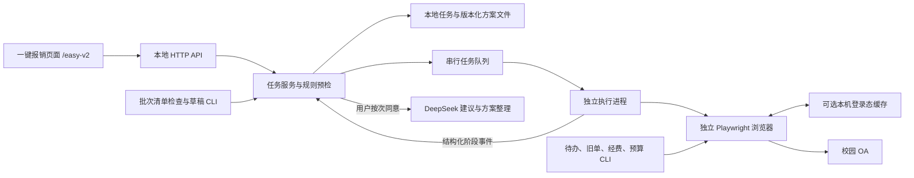
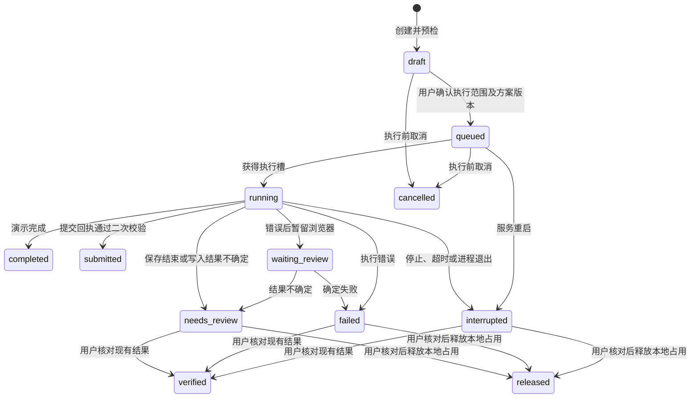

# 架构与线上迁移

本文按 2026-10-15 的源码整理，描述本机版已经实现的能力及其边界。接口接入与本地模拟测试不等于真实 OA 验收；后文的迁移事项仍是计划。

## 系统分层

V4 将原有 TypeScript/Playwright 报销脚本隔离为校园 OA 适配层，保留 SSO、空单复用、经费匹配、全电发票和个人银行卡支付处理。项目要求 Node.js 22 及以上，TypeScript 编译至 `dist/` 后运行。

| 层 | 主要入口 | 职责 |
| --- | --- | --- |
| 网页与本地 API | `public/`、`src/server/app.ts` | 发票检查、任务创建、确认执行、人工核验、建议及 JSON 方案查看下载 |
| 应用层 | `src/application/job-service.ts`、`invoice-batch.ts` | 预检、重复票据保护、串行队列、worker 生命周期、批次草稿 |
| 领域层 | `src/domain/job.ts`、`workflow.ts`、`reimbursement-plan.ts` | 金额及输入校验、任务状态、失败分类、回执规则、方案约束 |
| 本机存储与外部服务 | `src/infrastructure/` | 任务 JSON、不可覆盖的方案版本、PDF 解析、DeepSeek、站点规则加载 |
| 校园页面适配 | `src/automation/` | 浏览器及登录、经费和票夹控件、付款、保存及提交、查询接口、续跑保护 |
| 独立命令 | `src/cli.ts`、`connect.ts`、`tasks.ts`、`open.ts`、`funds.ts`、`budgets.ts`、`batch.ts` | 单票执行、连接检查、查询与旧单查看、批次准备 |

## 按报销类型隔离（新增报销类型的约定）

每种报销单的代码各自独立，即使有重复：改一种单据不会影响另一种。目前有用款申请单和境内差旅单两种，新增一种（如用车报销单、采购预付及报销单）照下表各建一份：

| 层 | 用款申请单 | 境内差旅单 | 新增类型 |
| --- | --- | --- | --- |
| OA 请求链（填写、提交） | `src/automation/http-fill.ts`、`http-submit.ts` | `src/automation/travel/`（`request`、`search`、`funding`、`invoices`、`payees`、`fill`、`submit`） | `src/automation/<类型>/`，从已有的一种复制后改 |
| 服务端 | `src/server/oa-api.ts`（任务队列 `fillJob`） | `src/server/travel-api.ts`（`TravelApi`，经 `TravelHost` 借用登录） | `src/server/<类型>-api.ts`，路由挂在 `/api/oa/<类型>/` 下 |
| 页面模块 | `public/js/apply-money.js` | `public/js/travel.js`、`itinerary.js` | `public/js/<类型>.js`，在 `core.js` 的表单注册表中 `registerForm(报销类型, {...})` |
| 测试 | `tests/http-fill.test.cjs`、`easy-oa.test.cjs` | `tests/http-travel.test.cjs`、`itinerary.test.cjs` | 请求链单元测试 + `tests/easy-page.spec.ts` 中一条页面流程 |

只有与单据类型无关的部分共用：登录与 HTTP 客户端（`http-login.ts`）、BPM 编码与查询（`http-bpm.ts`：经费、预算、报销单查询、新建/打开单据）、票夹接口（`invoice-claim.ts`）、供应商查询（`http-payee.ts`）、发票限额规则（`domain/invoice-rules.ts`）。页面上共用 `public/js/core.js`（请求、提示、可搜索下拉框、文件读取、表单注册表）、`login.js`、`funding.js`（经费与预算项选择）、`invoices.js`（发票）。共用模块不调用任何一种单据的代码：它们通过注册表询问当前单据（预算查询地址 `budgetsPath`、`onSubjects`、`onInvoices`、`onFund`、`reset`、`submit`），由 `main.js` 统一接线。

页面是浏览器原生 ES 模块（`<script type="module" src="/js/main.js">`），没有构建步骤；`src/server/app.ts` 的静态文件表列出每个模块。页面流程由 `tests/easy-page.spec.ts` 在真实浏览器中验证：所有 `/api` 请求在浏览器内应答，核对页面最终发出的请求体。

网页不持有长期 API Key，服务端不接受浏览器调试地址或任意网站地址。worker 只继承必要环境白名单，任务配置通过 IPC 传递；旧脚本的环境变量和模块状态限制在单个执行进程内。工作进程不把原始标准输出转存为任务日志，任务主要记录结构化阶段、错误分类和经过限制的核验信息。

当前服务的调度并发固定为 1。独立 CLI 不经过这条队列，因此尚无覆盖所有命令的同账号锁或会话租约。存储 API 带 `ownerId`，但当前固定为 `local`，只是未来认证和仓库替换的接缝，不是多用户隔离。

网页仅创建和展示 `mode=live` 的任务；后端 API、演示 worker 及测试仍保留 `mode=demo`。默认 `OA_LIVE_ENABLED=false` 表示网页真实执行未启用，不是网页自动进入演示模式。

## 本机文件与登录态

默认业务目录为 `data/`，由 `OA_DATA_DIR` 调整。任务存放在 `jobs/<任务ID>/`，包含 `job.json`、原始归档 `invoice.pdf`、执行时保留原文件名的 `upload/` 副本，以及可选的 `reimbursement.vN.json`。默认数据目录排除 Git，网页静态文件白名单不开放这些目录。

`JobStore` 以临时文件加重命名更新单份 `job.json`。它服务于本机单进程，不提供数据库事务、多实例一致性或整批文件写入回滚。

设置 `OA_REMEMBER_SESSION=true` 后，`session-state.ts` 管理 Playwright storageState，默认位置为 `<OA_DATA_DIR>/browser-session/storage-state.json`，可用 `OA_SESSION_STATE_PATH` 指定。父进程在启动 worker 前解析成绝对路径，避免 worker 的任务目录改变缓存位置。

- 缓存保留允许的学校域名 Cookie，以及允许的 HTTPS origin 下的 localStorage、IndexedDB；过期 Cookie 在读取及保存时过滤。
- 创建独立浏览器时加载缓存，学校页面认证通过后保存，已确认认证的会话关闭前更新。读取失败回到正常登录；写缓存失败不会重试报销写操作。
- 缓存目录权限为 `0700`、文件为 `0600`，通过临时文件和重命名更新。它是本机凭据文件，不进入任务 API、源码或常规日志，也没有额外的应用层加密。
- 账号密码模式不载入或覆盖手动登录账号的缓存。浏览器仍须检查登录状态，缓存不保证会话持续有效。
- storageState 不保存打开的标签页、sessionStorage、未保存表单或执行进度。当前仍按命令或任务启动浏览器，尚未实现常驻会话管理器。

本地网页使用独立的 `oa_session` 与 CSRF 校验防止普通跨站请求；这与学校 Cookie、BPM `csrfToken` 是不同机制，不提供学校身份认证，也不区分同一操作系统账号下的使用者。

## OA 查询与旧单查看

四个命令均使用独立浏览器并复用可选登录态，命令入口主动清除 CDP 附加配置。它们不执行创建、上传、付款、保存或提交，也不修改任务的办理状态。对应适配函数可由已有浏览器流程直接调用。

| 命令 | 请求及主要输入 | 结果与当前边界 |
| --- | --- | --- |
| `npm run oa:tasks -- ...` | 门户 `POST /custom/api/v2/casp-tdc/task/search`；标题、页码和筛选条件；`_t` 每次生成 | 页面内同源 `fetch`，查询单页；JSON 保存到 `oa-task-search/`，从 `pcViewUrl` 等办理链接提取 `targets`（区分办理与通知任务） |
| `npm run oa:open -- ...` | BPM `GET /bpm-new/rbReimbursement/showLoadRbReimbursement.job`；必填 `--biz-id`、`--task-id` | 核验目标 URL、可见表单及唯一单据编号；支持 `--document-number`、`--read-only`；交互终端中保留浏览器至 Enter 关闭 |
| `npm run oa:funds -- ...` | BPM `POST /bpm-new/easySearch.load`；对话框表单字段（`queryName=queryFundingItems`、`fundingItemKind`、账套等），原单 ID 或单据编号 | 打开并核验原单，在表单页面内带 `csrfToken`/`procTaskId` 发送；HTML 项目表格解析为 `list`，保存到 `oa-funding-search/` |
| `npm run oa:budgets -- ...` | BPM `POST /bpm-new/rbReimburFundingItems/queryChooseBudgetOutlays.ajax`；经费编号及原单两个 ID | 打开并核验原单，在活动表单 Frame 发起表单编码请求；响应保存到 `oa-budget-search/`，预算选择仍使用现有页面流程 |

本机启动脚本分别提供 `--tasks`、`--open`、`--funds`、`--budgets` 入口。参数与用法见 [待办接口](todo-task-api.md)、[旧单直开](open-reimbursement.md)、[经费列表](funding-list-api.md)、[预算科目](budget-outlays-api.md)。

待办和预算请求由当前页面自动携带 Cookie 及浏览器请求头；经费列表请求使用浏览器上下文共享的 Cookie 存储。接口请求不跟随重定向，认证拒绝、超时和异常响应会明确报错。三个查询命令只输出保存路径及请求状态，结果目录为 `0700`、文件为 `0600`。经费接口的 HTML 作为字符串保存，不注入网页或执行脚本。

预算请求保留 `accountBook`、`reimbursementKind`、`fundingItemsCode`、`page`、小写 `pagesize` 和固定 `sortfields=[]`。每次在当前表单内读取明确命名的 token 候选：input/meta、`window.csrfToken`、jQuery 默认 Ajax headers。只有唯一有效值才发送；缺失、冲突或格式异常均停止，不从 URL 或用户粘贴的请求中复用 token，token 不传回 Node，响应中回显的当前 token 会脱敏。这些来源仍是待实网确认的兼容候选。

当前没有经实网校准的查询响应字段映射。HTTP 200 可能包含业务错误，经费列表也可能返回搜索页面；不能据此宣称已经获得完整项目、有效预算、余额或成功办理结果。查询接口尚未连接网页经费下拉框，也没有形成“待办响应自动选任务 → 打开 → 续办”的完整链路。

## 发票、批次与版本化 JSON

单个任务仍只接收一张可提取文字、可唯一识别 20 位号码的全电发票 PDF。检查同时保存原始字节 SHA-256 和大小，并从物理文本行里的明确标签尝试读取价税合计；不能唯一识别时不猜金额。金额比较使用整数分。单票任务允许人工填写金额，已知票面金额时拒绝超额；批次检查要求能核对票面金额。

`batch:check` 核对清单与源目录 PDF 集合、源路径、分类确认、发票号码/SHA-256/大小/票面金额、报销参数及重复占用。`batch:draft` 在整批预检通过后逐张创建 `live`、`action=submit` 的本地 `draft`，不连接 OA、不入执行队列，也不把多张票合并成一单。

清单出现 `liveForms`、已有 `jobId`/单据号或不明确的办理状态时，整个批次拒绝重新建任务；不能跳过部分记录后自动补建。清单记录不等于实时 OA 查询。草稿写入按张进行，没有跨任务事务；写入途中失败须检查已生成草稿，不能把预检通过理解为整批提交成功。

可选的 JSON 方案链路由 `generatePlan`、`reimbursement-plan.ts` 和 `reimbursement-plan-store.ts` 实现：

1. 用户按次同意后，仅为已上传发票的真实 OA 草稿调用 DeepSeek。外发用途、说明、实报金额、附件数、经费参数及票面金额；原始 PDF、票号、路径、收款人工号及登录凭据不外发。
2. 模型只整理摘要和核实事项，返回的业务输入必须逐字段等于已填内容。字段多余、遗漏、数字或经费参数改变都会拒绝保存；模型不选择控件、路径或办理动作。
3. 本地合并完整输入、发票引用、任务 ID 和执行范围，形成 `schemaVersion: 1` 的 `reimbursement.vN.json`；每次新建版本且禁止覆盖，任务保存版本号、文件名及 SHA-256 引用。
4. API 可查看或下载当前方案。确认执行须提交当前 `planSha256`；入队、出队启动 worker、worker 加载自动化前均校验方案与任务、发票文件的一致性。旧版本确认、文件缺失或篡改不会启动 OA。

方案是可检查的参数快照，不是独立的任意指令执行格式，也不是政策审批或科目有效性证明。没有生成方案的任务仍可按原本的已确认输入执行。批次清单、方案版本和任务事件均未构成可自动恢复的单据检查点。

## 任务状态与回执

协议还保留 `waiting_manual` 与人工反馈接口，兼容人工流转接管；当前默认 worker 不发送人工流转事件，而是在执行范围获确认后自动核对表单和 OA 路线，单次点击最终确定。服务重启会把 `queued`、`running`、`waiting_manual`、`waiting_review` 标为 `interrupted`，不会自动重放。

`contracts.ts` 为每一阶段声明操作、成功证据和恢复方式；详见 [真实流程说明](oa-flow.md)。通过 `OA_SITE_PROFILE` 加载的站点配置提供保存业务响应判断及刷新后的回执定位规则。保存时可观察指定 POST 的业务成功字段，再刷新读取同一单据；提交后需重新读取单号、金额和明确配置的流程状态。父进程再核对提交范围、已核验摘要、回执来源及金额，符合条件才记录 `submitted`。

当前真实保存任务在服务层仍进入 `needs_review`，即使适配层附有保存回执；`submitted` 只用于符合规则的提交回执。最终提交已点击但缺少可靠站点回执时保留结果未知，不重复提交。`verified` 记录用户人工核验，既不等于自动提交回执，也不等于审批通过；`released` 仅释放本地票据占用，不删除或修改 OA 单据。

## 自动化恢复与重复操作保护

重放创建、上传、付款或保存可能产生重复财务记录。`runner.ts` 只有“打开工作台”允许整阶段重试，其他阶段单次执行；底层等待、状态回读与有证据约束的局部恢复另行处理：

| 情况 | 当前处理 |
| --- | --- |
| 指定续跑但找不到 BPM 标签页 | 停止，不退回新建；多个候选明确报错 |
| 找到唯一续跑页面 | 可按显式阶段或当前控件推断入口；仍不是持久化单据检查点恢复 |
| 通过 ID 打开旧单遇到明确认证失效 | 单次 CAS SSO 后回到同一目标；403、单号不符或未知页面不自动换单 |
| 新建菜单登录超时 | 仅在无业务 ID、无编辑页、未上传、未进入提交且非续跑/复用时，返回登录和工作台恢复一次 |
| 打开提交确认窗无变化 | 仅完全没有请求、没有页面变化时最多尝试三次；最终确定只点击一次 |
| 发票、经费或支付回读不匹配 | 停止；不删除付款行、不强改只读总额、不循环重传发票 |
| 错误需要查看现场 | 网页任务进入 `waiting_review`，停止自动操作，浏览器最多保留五分钟；关闭后按失败是否确定落状态 |

CLI 的 `START_FROM` / `RESUME_EXISTING` 依赖仍存在的页面，标签页选择保护不能替代单号、票号、项目和金额的完整恢复核验。独立旧单命令已提供更严格的目标身份检查，但尚未把它接入完整的自动续办执行器。

经费和支付关键路径使用控件操作及逐字段回读，金额以整数分核验；发票选择按列和完整号码匹配，并观察列表请求及渲染稳定状态。现有适配仍含校园 DOM、LigerUI、VXE 等控件差异，页面改版需要实际证据和回归夹具。

## 上线仍需实现的工作

1. **学校身份认证与授权**：接入学校允许的 OIDC/CAS/SSO，由服务端生成身份并校验本人数据访问；本机固定 owner 与共享缓存不得直接充当多租户设计。
2. **数据库与存储**：用 PostgreSQL 等事务仓库替换本地 JobStore，任务、事件、票据和方案版本分表；按用户和票据建立约束。文件迁移到私有对象存储，明确加密、保留期及删除规则。
3. **持久化队列与会话管理**：替换内存队列，增加账号锁、租约和 worker 心跳；先移除任务对环境变量和模块全局状态的依赖，再实现批次常驻浏览器。队列恢复不代表允许重放 OA 写操作。
4. **单据检查点与多票执行**：建立单据号、票号集合、科目分摊、金额、已尝试/已核验阶段和证据来源的持久化检查点；重新查询原单后决定可跳过或继续的操作。现有逐票草稿工具不能替代合并单执行器。
5. **接口和回执实网校准**：确认待办字段、经费列表含义、预算 token 来源及返回字段；验证保存响应、刷新回执、原单身份和当前权限后再接入自动选择。缺少字段证据时保留原始查询结果，不猜写接口。
6. **浏览器交互与失败证据**：线上 worker 运行于受限环境，按会话提供验证码及二次认证界面；不得共享个人 Chrome CDP。增加脱敏的局部 DOM、截图和允许的响应字段作为回归证据，登录字段及原始请求头不进入长期产物。
7. **规则与 AI**：接入带版本和生效日期的校方制度，明确票种、额度及附件要求；AI 仅解释和提示。增加配额、费用监控及经确认的数据外发策略。
8. **依赖与运维**：升级遗留 `pdf-parse 1.x`/PDF.js 并做票据回归；当前 `Uint8Array` 副本和禁用字体脚本求值不替代解析进程的资源隔离。上线前补齐大文件、超多页、损坏文件及进程异常隔离，增加 HTTPS、监控、备份和恢复演练。

[浏览器自动化方案](browser-automation-plan.md) 保留分阶段改造思路，其审计快照与计划应结合本文和当前源码理解。已实现登录态缓存、续跑标签保护和 ID 直开；常驻会话、单据检查点、合并单执行及系统化脱敏失败证据仍未完成。

## 已知限制与验证方式

- 网页和自动执行器仍是一任务一张文本型全电发票；批次工具只生成逐票草稿，不支持扫描件 OCR、行程单、发票真伪查验或自动多票合并。
- 本地 PDF 只提取可明确识别的号码和价税合计，不独立核定税额、品目合规性或经费科目适用性；未提供官方制度时不推测额度和审批标准。
- 默认二十分钟任务上限包含人工等待。停止只能阻止后续步骤，不能撤回已发送到 OA 的请求。
- 默认独立浏览器、可选登录态缓存和本机队列均不提供多实例互斥；真实账号不应通过多个独立命令同时写同一单据。
- 持久化任务和方案文件用于本机单进程，不具备数据库级故障恢复和跨任务事务。

领域及服务测试覆盖输入和金额、PDF 文本及总额、重复票据和文件变化、串行执行、批次已有单据保护、版本化方案一致性、人工核验和服务重启。HTTP 测试覆盖本地 Host/Origin、会话与 CSRF、私有文件、方案下载及模拟子进程链路。

查询适配测试使用合成会话、页面回调或请求替身验证参数、活动 Frame、token 候选、错误处理、文件权限和清理。Playwright 的本地夹具覆盖控件、发票、经费、付款、保存和提交边界。上述测试不使用真实 Cookie，不构成真实 OA 成功办理的证据；接口字段、现场 DOM 和站点回执仍须校园环境验收。运行方式以 `package.json` 和 [项目说明](../README.md) 为准。
